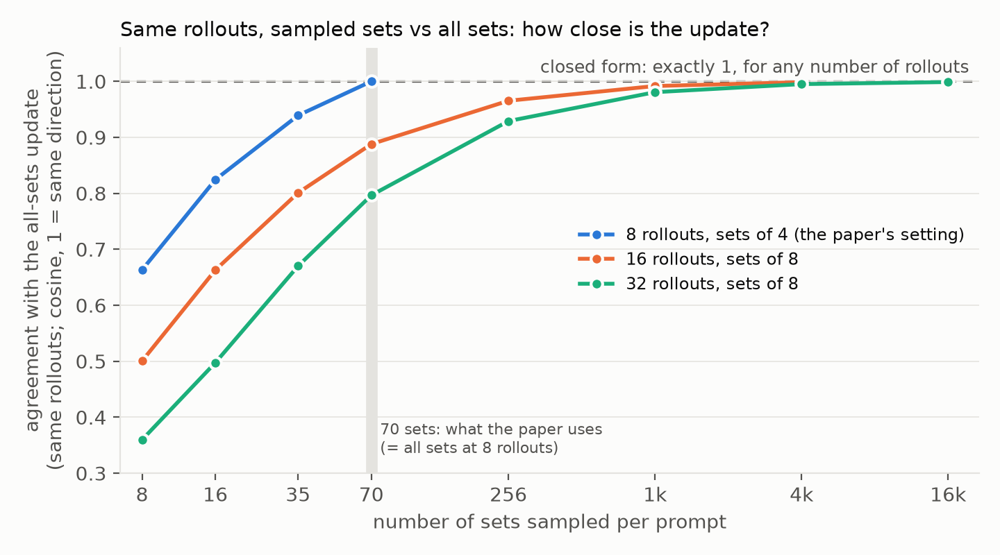
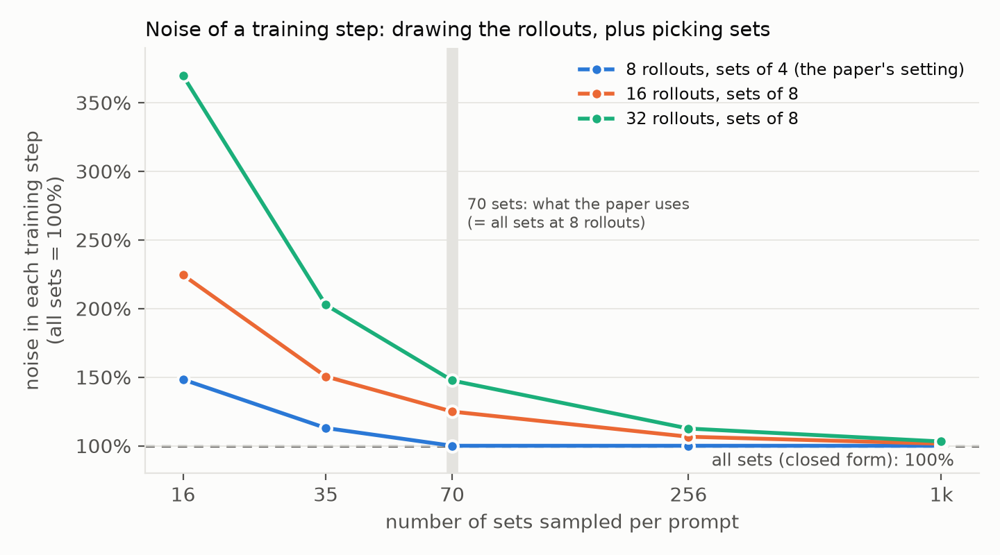
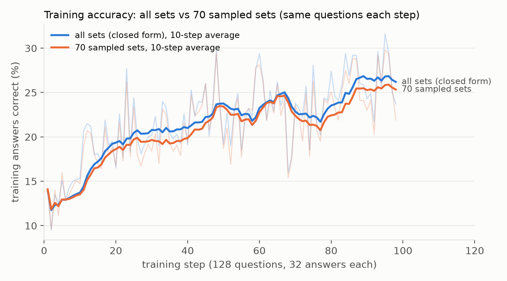

this builds on [Poly-EPO: Training Exploratory Reasoning Models](https://arxiv.org/html/2604.17654v3) (Orney, Hamid et al., 2026), mainly sections 3–4 and eqs. (8), (10) and (11).

poly-epo scores sets of answers for correctness and strategy diversity. there are 70 sets at $N=8$, $n=4$, but about 10 million at $N=32$, $n=8$. sampling sets avoids enumeration, but adds noise to the advantages.

we keep the judged rollouts fixed and average over the choice of sets: rao–blackwellization. for poly-epo, we can compute this average from strategy counts and reward totals, without listing any sets.

## the advantage

for one prompt, the model generates $N$ rollouts. rollout $i$ has a binary reward $r_i$ and a judge-assigned strategy label $c_i$. junk answers share a label excluded from the diversity count. a set $G$ contains $n$ rollouts and scores

$$
f(G)=\underbrace{\frac1n\sum_{j\in G}r_j}_{\text{average reward}}\times\underbrace{\frac{\#\{\text{strategies in }G\text{, junk excluded}\}}{n}}_{\text{diversity}}.
$$

the advantage is the average score of sets containing $i$, minus the average over all sets:

$$
A_i=\mu_i-b,\qquad \mu_i=\operatorname{avg}_{G\ni i}f(G),\qquad b=\operatorname{avg}_{G}f(G).
$$

## averaging over sets

write $S_G=\sum_{j\in G}r_j$ and $c\in G$ when strategy $c$ appears in $G$. the diversity count is a sum of indicators, so

$$
b=\frac1{n^2}\sum_{c\text{ non-junk}}\mathbb E[S_G\mathbf1\{c\in G\}].
$$

for each strategy, take the total reward contribution and subtract the part from sets missing that strategy:

$$
\mathbb E[S_G\mathbf1\{c\in G\}]
=\mathbb E[S_G]-\Pr(c\notin G)\,\mathbb E[S_G\mid c\notin G].
$$

let $R$ be the total reward, $m_c$ the number of rollouts in strategy $c$, and $R_c$ their total reward. then

$$
b=\frac1{n^2}\sum_{c\text{ non-junk}}
\left[\frac{nR}{N}-\frac{\binom{N-m_c}{n}}{\binom Nn}\frac{n(R-R_c)}{N-m_c}\right].
$$

for $\mu_i$, fix rollout $i$ in the set. the expected reward sum is $B_i$; another strategy $c$ is missing with probability $q_{c\mid i}$:

$$
B_i=r_i+\frac{n-1}{N-1}(R-r_i),\qquad
q_{c\mid i}=\frac{\binom{N-m_c-1}{n-1}}{\binom{N-1}{n-1}}.
$$

$i$'s own strategy is always present. for the others, use the same subtraction:

$$
\mu_i=\frac1{n^2}\Big[\mathbf 1\{c_i\text{ non-junk}\}\,B_i+\sum_{\substack{c\text{ non-junk}\\c\neq c_i}}\Big(B_i-q_{c\mid i}\big(r_i+\tfrac{n-1}{N-m_c-1}(R-R_c-r_i)\big)\Big)\Big].
$$

then $A_i=\mu_i-b$, in $O(N\times\text{number of strategies})$ work. if a strategy cannot be missed, its subtraction term is zero. handle $n=1$ by scoring single rollouts, and $n=N$ by returning zero advantages. use log-binomials for large $N$.

against brute-force listing on 1,100 batches ($1\le n\le N\le10$), including one strategy, all distinct strategies, and all-zero or all-one rewards, the largest error was $4\times10^{-16}$.

## relation to sampling

let $\hat A_i$ use $K$ uniformly sampled sets, with the same subtraction of averages. if no sampled set contains $i$, it is set to zero. for $n<N$, with independent draws or sampling without replacement,

$$
\mathbb E[\hat A_i\mid\text{rollouts, rewards and labels}]
=c_KA_i,\qquad
c_K=1-\frac{N}{N-n}\Pr(\text{no sampled set contains }i).
$$

so $c_KA_i$ is the rao–blackwellized sampled estimator. we use $A_i$, dropping the common scale factor. $c_K$ approaches 1 as the probability of missing a rollout goes to zero; rollout-sampling noise remains.

with 32 rollouts and 8 sampled sets of size 4, about 34% of rollouts are never selected and receive zero advantage. over repeated set draws, sampled advantages average 0.607 times their exact all-sets values, matching the prediction.

## policy gradient

if each label depends only on its own response, averaging over rollout batches gives the paper's proposition 3.1 with an explicit constant:

$$
\mathbb E\Big[\sum_i\nabla\log\pi(y_i)\,A_i\Big]=\frac{N-n}{n}\,\nabla\,\mathbb E[f(y_{1:n})].
$$

on a three-action toy policy with fixed labels ($N=6$, $n=4$), listing all 729 batches gives exactly $\frac12\nabla\mathbb E[f]$, within $5\times10^{-16}$.

## results

we use the paper's math setup: Qwen3-4B-Base on POLARIS-53K, the same math-verify reward and clustering prompt, and a local Qwen3-4B-Instruct-2507 judge. the noise measurements use the starting model; the final section compares training runs.

we generate 32 rollouts for each of 256 random training prompts (temperature 1, up to 4,096 tokens). we compare updates $\sum_i\nabla\log\pi(y_i)\,A_i$, replacing $A_i$ with $\hat A_i$ for sampled sets.

- the judge labels the first 8, 16 and 32 rollouts in separate calls. 24 of 768 calls failed; each rollout was then assigned its own strategy, as in the authors' code.
- 15% of rollouts are correct. 30% of prompts have no correct rollout at 32 and hence zero advantage; excluding them leaves 177 prompts. the judge finds 3.2 strategies per prompt and labels 18% of rollouts as junk.
- gradients are random sketches of 262,144 numbers rather than 4 billion, with inner products accurate to about 0.4%. measuring noise on advantages alone gives the same picture within 25%.

### checking the formula

compare enumeration and the closed form on the same judged rollouts, with $n=4$ as in the released implementation. times cover advantage calculation for 256 prompts, excluding generation and judging:

| rollouts $N$ | largest advantage difference | enumeration | closed form |
| ------------ | ---------------------------------- | ---------- | ----------- |
| 8            | $5\times10^{-16}$                  | 0.09 s     | 0.11 s      |
| 16           | $2\times10^{-15}$                  | 1.8 s      | 0.07 s      |
| 32           | $2\times10^{-14}$                  | 21 s       | 0.07 s      |

both methods agree up to float64 rounding (largest advantage about 0.2). enumeration is already cheap at $N=8$ but the closed form clearly helps at larger $N$. other set sizes match brute-force enumeration to $2\times10^{-15}$.

at $N=64$, $n=16$ ($5\times10^{14}$ sets), the formula takes 0.03 s for 128 prompts on a CPU. a 10-step check inside the Poly-EPO trainer at $N=8$, $n=4$ also matched on every batch: 0.000 difference at log precision, largest advantage 0.125.

### changing the sampled sets

keep the rollouts and judge labels fixed. draw $K$ sets, compute the update, and repeat 64 times per prompt. compare the sampled and exact all-sets updates by cosine (1 = the same direction).

at 32 rollouts, the cosine with the exact update rises from about 0.8 with 70 sampled sets to 0.995 with 4,096 sets. sampling more sets approaches the update that the closed form computes directly.

### changing the rollouts

now generate new answers: 4 independent batches of 32 rollouts for each of the same 256 prompts, with the model unchanged. judge each batch and compute its exact update. variation across batches measures rollout noise, including rejudging. we compare this with the extra variance from sampling sets.

the plot shows total update variance as a percentage of rollout variance. each curve has its own all-sets baseline at 100%; values above it are the extra variance from set sampling.

| rollouts, set size | added variance, 70 sets | set sampling's share of total variance |
| --- | --- | --- |
| 8, sets of 4 (paper) | none (70 is all sets) | 0% |
| 16, sets of 8 | +25% | 20% |
| 32, sets of 8 | +48% | 32% |

at 32 rollouts, if rollout variance is 100 units, sampling 70 sets adds 48: total variance becomes 148, of which 32% comes from set sampling. sampling 256 or 1,024 sets adds 13% or 3% instead. these are variance measurements, not training-speed gains.

### training with exact or sampled advantages

we train two models for a target of 100 steps: exact advantages versus 70 sampled sets. both use the Poly-EPO trainer, 32 rollouts, sets of 8, 128 questions per step, and learning rate $10^{-6}$, with the same questions and other settings:

training accuracy: the fraction of generated training answers that are correct, averaged over each step range.

| steps | all sets | 70 sampled sets |
|---|---|---|
| 1–20 | 16.5% | 16.1% |
| 21–40 | 20.9% | 19.8% |
| 41–60 | 23.5% | 23.1% |
| 61–80 | 23.2% | 22.4% |
| 81–98 | 26.5% | 25.5% |

## conclusion

in short, the formula removes set-sampling noise and, personally most gratifying to me, the need to choose $K$. at the paper's size, all 70 sets are cheap to enumerate; the benefit is computing exact advantages at larger $N$ and $n$. the judge cost is unchanged.

the training gain over 70 sampled sets is small over these few iterations, but it is consistent.

## code

closed-form implementation and tests: [mh-amani/polyepo, branch scaling-polyepo-to-many-groups](https://github.com/mh-amani/polyepo/tree/scaling-polyepo-to-many-groups).
